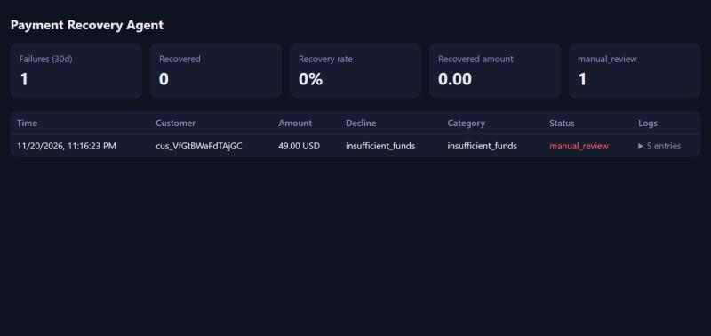
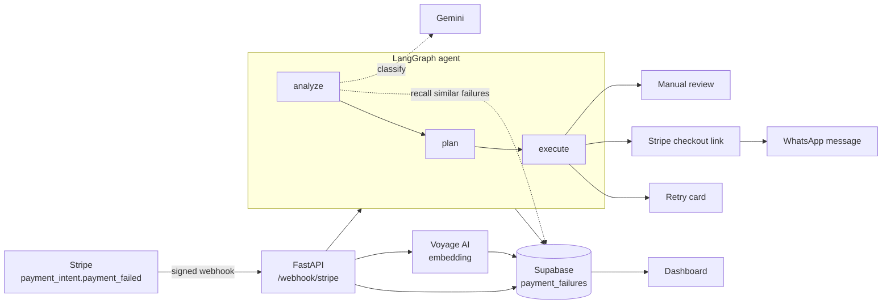

# Payment Recovery Agent

An AI agent that wins back failed card payments. When a Stripe payment fails, it works out why, decides on a recovery plan, and carries it out: it retries the card, sends the customer a fresh checkout link over WhatsApp, or flags the payment for a human. Every decision is logged to a live dashboard.



## How the agent works



1. **Webhook** ([app.py](app.py)): Stripe sends `payment_intent.payment_failed`. The signature is verified and the event id is stored as unique, so Stripe's retries are never processed twice. The handler replies at once and does the work in the background.
2. **Memory** ([memory.py](memory.py)): the failure is saved to Supabase together with a Voyage AI embedding of the decline details. The `match_failures` function returns the same customer's past failures first, then the most similar failures overall.
3. **Analyze** ([graph.py](graph.py), [classifier.py](classifier.py)): Gemini reads Stripe's error data and that history, then returns a category and a one-sentence root cause as structured JSON. If a Gemini model is overloaded or out of quota, the next one in the list is tried. A card check ([tools.py](tools.py)) uses Stripe's own card metadata and Radar risk level, so no card data is sent to a third party.
4. **Plan**: rules decide the next step:

   | Situation | Action |
   |---|---|
   | `processing_error` | retry the same card once, then send a checkout link |
   | insufficient funds, expired card, wrong details, 3DS, generic decline | send a new checkout link over WhatsApp |
   | fraud, Radar risk `elevated`/`highest`, or 3+ past failures for the customer | manual review, no contact |
   | no phone number on file | create the link, mark for manual review |

5. **Execute** ([tools.py](tools.py)): retries the PaymentIntent, creates a Stripe Checkout link tagged with `metadata.failure_id`, and sends it with an approved WhatsApp template. The result and every step's log go back to Supabase.
6. **Recovered**: when `payment_intent.succeeded` arrives for the original payment, or for a checkout carrying `failure_id`, the failure is marked recovered and counted on the dashboard.

## Tech stack

| Part | Technology |
|---|---|
| API and webhook | Python, FastAPI, Uvicorn |
| Agent | LangGraph state machine (`analyze → plan → execute`) |
| LLM classifier | Google Gemini (`gemini-3.8-flash`, falls back to `3.5-flash` and `3.1-flash-lite`) |
| Embeddings | Voyage AI `voyage-3.5` (1024 dimensions) |
| Database and vector search | Supabase Postgres with pgvector |
| Payments | Stripe (PaymentIntents, Checkout, webhooks, Radar) |
| Customer messages | WhatsApp Cloud API (Meta) |
| Dashboard | Plain HTML and JS served by FastAPI, refreshes every 5 seconds |
| Tests | pytest, all external services stubbed |

## Project layout

| File | What it does |
|---|---|
| [app.py](app.py) | FastAPI app: Stripe webhook, dashboard, metrics API |
| [classifier.py](classifier.py) | Gemini failure classifier |
| [graph.py](graph.py) | LangGraph agent and recovery policy |
| [tools.py](tools.py) | Card check, retry, checkout link, WhatsApp |
| [memory.py](memory.py) | Supabase storage, embeddings, similar-failure recall, metrics |
| [schema.sql](schema.sql) | Table, indexes, permissions and `match_failures` function |
| [dashboard.html](dashboard.html) | Dashboard page |
| [test_agent.py](test_agent.py) | Offline tests |

## Setup

### 1. Accounts and keys

| Variable | Where to get it |
|---|---|
| `GEMINI_API_KEY` | [Google AI Studio](https://aistudio.google.com/apikey) |
| `STRIPE_SECRET_KEY` | Stripe Dashboard → Developers → API keys (use the `sk_test_` key) |
| `STRIPE_WEBHOOK_SECRET` | printed by `stripe listen` (step 4) |
| `SUPABASE_URL`, `SUPABASE_SERVICE_KEY` | Supabase project → Settings → API |
| `VOYAGE_API_KEY` | [Voyage AI dashboard](https://dashboard.voyageai.com/) |
| `WHATSAPP_TOKEN`, `WHATSAPP_PHONE_ID` | Meta developer app → WhatsApp → API Setup |
| `WHATSAPP_TEMPLATE` | an approved template with two body params: `{{1}}` amount, `{{2}}` link |
| `DASHBOARD_PASSWORD` | any password you choose |

Free tiers are enough to try it. Without a payment method, Voyage allows only 3 requests a minute and Gemini has a small daily quota per model.

### 2. Database

Open the Supabase SQL Editor for your project, paste [schema.sql](schema.sql) and press Run.

### 3. Install and run

```bash
python -m venv .venv
```

```bash
.venv/Scripts/pip install -r requirements.txt
```

(On macOS or Linux use `.venv/bin/pip`.)

Copy `.env.example` to `.env`, fill it in, then start the app:

```bash
.venv/Scripts/python -m uvicorn app:app --env-file .env --port 8000
```

### 4. Connect Stripe

Install the [Stripe CLI](https://docs.stripe.com/stripe-cli), then forward events to the app. Use the same Stripe account as `STRIPE_SECRET_KEY`:

```bash
stripe listen --events payment_intent.payment_failed,payment_intent.succeeded --forward-to localhost:8000/webhook/stripe
```

Copy the `whsec_...` it prints into `STRIPE_WEBHOOK_SECRET` and restart the app.

### 5. Try it

Create a test payment that gets declined for insufficient funds:

```bash
stripe payment_intents create --amount 4900 --currency usd --payment-method pm_card_chargeDeclinedInsufficientFunds --confirm=true -d "automatic_payment_methods[enabled]=true" -d "automatic_payment_methods[allow_redirects]=never"
```

Open http://127.0.0.1:8000, sign in with any username and your `DASHBOARD_PASSWORD`, and watch the failure appear with its category, plan and logs.

### Tests

The tests run offline, with every external service stubbed:

```bash
.venv/Scripts/python -m pytest -q
```
